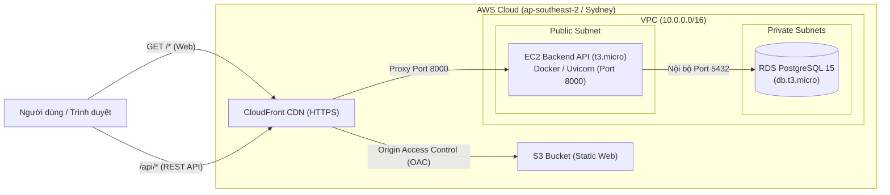

# Hướng dẫn Triển khai LumiLab trên AWS (All-in-One)

Tài liệu này hướng dẫn triển khai toàn diện hệ sinh thái LumiLab (Web, Backend API, Database PostgreSQL) lên nền tảng Amazon Web Services (AWS) với mức chi phí tối ưu (tận dụng AWS Free Tier hoặc AWS Student/Educate Credits $100).

---

## 1. Kiến trúc triển khai

Hệ thống được thiết kế theo mô hình tách biệt hiệu năng cao và bảo mật:



* **Frontend (Web):** Single Page Application (React + Vite) đóng gói tĩnh đưa lên **Amazon S3**, phân phối toàn cầu qua **Amazon CloudFront** với chứng chỉ SSL/TLS tự động (HTTPS). Bảo mật qua CloudFront Origin Access Control (OAC), chặn truy cập public trực tiếp vào bucket.
* **Backend API:** Container Docker chạy trên máy ảo **Amazon EC2 `t3.micro`** (Ubuntu 24.04 LTS), có cấu hình tự động 2GB Swap Memory để đảm bảo build và chạy ổn định.
* **Cơ sở dữ liệu (Database):** **Amazon RDS PostgreSQL 15 (`db.t3.micro`)** đặt trong Subnet riêng, chỉ mở cổng 5432 nội bộ cho EC2 thông qua Security Group.
* **Định tuyến thống nhất:** CloudFront định tuyến toàn bộ request:
  * `/api/*` $\rightarrow$ Chuyển tiếp tới EC2 API.
  * `/*` $\rightarrow$ Phục vụ giao diện người dùng từ S3 (hỗ trợ Single Page App routing qua Custom Error Response 403/404 $\rightarrow$ `index.html`).

---

## 2. File cấu hình

* **Template tự động:** [`deploy/aws/lumilab-cloudformation.yaml`](lumilab-cloudformation.yaml)
  * Tự động khởi tạo VPC, Internet Gateway, Route Tables, 2 Subnet đa vùng, Security Groups.
  * Tự động cấu hình RDS PostgreSQL 15 `db.t3.micro` (tương thích Free Tier).
  * Tự động cấu hình EC2 `t3.micro` tự tải mã nguồn, build container Docker API và kết nối RDS.
  * Tự động cấu hình S3 Bucket, CloudFront OAC và CloudFront Distribution với 2 Origins + Behaviors.

---

## 3. Quy trình triển khai từng bước

### Bước 1: Build mã nguồn Web (Frontend)
Tại máy local, chạy lệnh build production để tạo thư mục `apps/web/dist`:
```powershell
npm run build:web
```

### Bước 2: Tạo Stack CloudFormation trên AWS Console
1. Đăng nhập [AWS Management Console](https://console.aws.amazon.com/cloudformation).
2. Chọn Region mong muốn (ví dụ: `ap-southeast-2` - Sydney).
3. Vào dịch vụ **CloudFormation** $\rightarrow$ Bấm **Create stack** $\rightarrow$ Chọn **With new resources (standard)**.
4. Chọn **Upload a template file** $\rightarrow$ Chọn file [`deploy/aws/lumilab-cloudformation.yaml`](lumilab-cloudformation.yaml).
5. Đặt tên Stack (ví dụ: `lumilab`).
6. Nhập các tham số:
   * `DBPassword`: Mật khẩu cho cơ sở dữ liệu PostgreSQL (tối thiểu 8 ký tự).
   * `LatestAmiId`: Giữ nguyên mặc định (Ubuntu 24.04 LTS).
7. Bấm **Next** qua các bước và bấm **Submit** để khởi tạo.
8. Đợi khoảng **10 - 15 phút** để AWS hoàn tất khởi tạo RDS, EC2 và CloudFront CDN. Khi thấy trạng thái **`CREATE_COMPLETE`** (màu xanh lá):
   * Chuyển sang tab **Outputs** để lấy:
     * `CloudFrontURL`: Đường dẫn web public (ví dụ: `https://d2s97mh9po987y.cloudfront.net`).
     * `S3BucketName`: Tên bucket S3 để upload web.
     * `EC2PublicIP`: IP máy chủ API backend.

### Bước 3: Upload giao diện Web lên Amazon S3
1. Vào dịch vụ **Amazon S3** trên AWS Console $\rightarrow$ Bấm vào tên Bucket vừa tạo (theo `S3BucketName`).
2. Bấm nút **Upload**.
3. Mở thư mục `apps/web/dist` trên máy tính:
   * **Bôi đen toàn bộ 3 mục bên trong `dist`** (gồm thư mục `assets`, file `build-info.json`, file `index.html`).
   * *Lưu ý quan trọng:* Không kéo cả thư mục cha `dist`, chỉ kéo các mục **bên trong** nó thả trực tiếp vào S3.
4. Bấm **Upload**.

---

## 4. Kiểm tra và Nghiệm thu

Sau khi upload, hệ thống đã hoàn toàn sẵn sàng. Kiểm tra các endpoint qua link CloudFront:

```powershell
# 1. Kiểm tra Web Frontend
curl -I https://<CloudFrontDomain>/

# 2. Kiểm tra danh mục thí nghiệm qua API
curl -s https://<CloudFrontDomain>/api/v1/labs

# 3. Kiểm tra thông tin hệ thống và phiên bản
curl -s https://<CloudFrontDomain>/api/v1/system

# 4. Kiểm tra trạng thái AI Tutor RAG
curl -s https://<CloudFrontDomain>/api/v1/tutor/status
```

Tất cả các endpoint trên đều phải trả về HTTP `200 OK`.

---

## 5. Quản lý chi phí và Vận hành

* **Mức tiêu hao chi phí:**
  * S3 Storage (<10MB) & CloudFront (1TB miễn phí/tháng): Chi phí gần như bằng $0.
  * EC2 `t3.micro`: 750 giờ/tháng miễn phí (Free Tier) hoặc ~$0.013/giờ khấu trừ credit.
  * RDS `db.t3.micro`: 750 giờ/tháng miễn phí (Free Tier) hoặc ~$0.021/giờ khấu trừ credit.
  * Tổng chi phí dự kiến nếu chạy 24/7 khoảng $15 - $25/tháng, hoàn toàn được đài thọ bởi gói **$100 AWS Credits (182 ngày)**.
* **Tạm dừng khi không dùng để tiết kiệm credit:**
  * Khi không cần demo hoặc chấm bài, có thể vào bảng điều khiển **EC2** $\rightarrow$ chọn instance $\rightarrow$ **Stop Instance**.
  * Khi cần tiếp tục demo $\rightarrow$ **Start Instance**.
* **Xóa toàn bộ khi hoàn thành môn học / dự án:**
  * Vào S3 bucket $\rightarrow$ Empty bucket (xóa hết file đã upload).
  * Vào CloudFormation $\rightarrow$ Chọn stack `lumilab` $\rightarrow$ Bấm **Delete** để giải phóng toàn bộ tài nguyên trong 1 lần.

