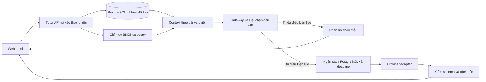

# Kiến trúc LLM và Lumi Tutor

Sơ đồ được chuyển và cập nhật từ [kiến trúc repo A tại `f5f233f`](https://github.com/PhucTruong11/lumilab/blob/f5f233f8dc2ee21934e6b77c740e7959fecb102a/docs/ARCHITECTURE.md). Các bước dưới đây mô tả code đang có ở B. [Contract API](CONTRACT.md)

| Bước | Điểm triển khai và hành vi |
| --- | --- |
| Tính và lưu kết quả | Engine tính snapshot. API Verify tính lại độc lập. Nếu Tutor nhận `run_id`, API chỉ đọc lượt hợp lệ trong đúng phiên. Preview draft giữ riêng trong phản hồi. |
| Dựng context | Route Tutor lấy học liệu theo lab và bậc học, rồi dựng context từ câu hỏi, kết quả truy xuất và lượt đã lưu nếu có. Gateway chọn skill theo mode từ danh sách cố định. |
| Xét điều kiện gọi model | Luật local kiểm câu hỏi, lịch sử và văn bản truy xuất. Gateway kiểm phạm vi pilot, cấu hình live, duyệt khoa học, quyền gửi nguồn và route phù hợp với audience. Prompt Guard qua provider là tùy chọn. |
| Gọi, cache và fallback | Cache được tách theo phiên và phiên bản context. PostgreSQL giữ ngân sách và đếm lần gọi. Gateway có deadline chung và giới hạn lần thử. Adapter xử lý từng provider. Kết quả đi qua kiểm schema và ID nguồn trước khi trả về UI. |

Các route Gemini và Groq có thứ tự và cờ bật riêng trong registry. Tại baseline B, live tắt, event cap bằng `0` và các route provider đều tắt. Phạm vi live trong code hiện là `pendulum`, `circuit`, `chemistry`. Các mã bài của dataset B cần được ánh xạ trước khi mở rộng. [Registry provider](../knowledge/pipeline/providers.json) · [Gateway](../apps/api/src/lumilab_api/llm_gateway.py) · [Luồng RAG](DATA-RAG-TUTOR.md)
